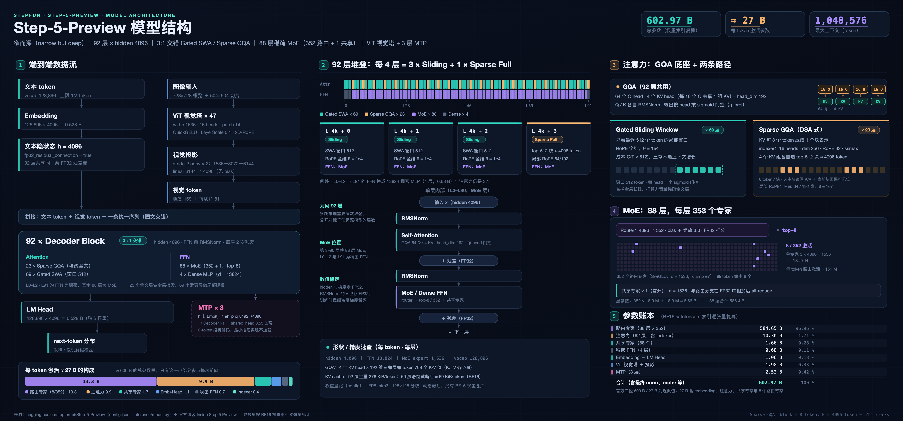

# model-arch · 大模型结构图解

把开源/半开源大模型的**结构**拆开画清楚：层数、注意力类型、MoE 路由、张量形状、参数账本，
做成可交互的单页静态网页，直接部署到 GitHub Pages。

> 当前收录：**Step-5-Preview**（StepFun，600B 总参 / 27B 激活 / 1M 上下文）



---

## 页面里有什么

`index.html` 是一个**零依赖、单文件**的交互页（内置 CSS/JS，不联网也能开）：

| 区块 | 内容 |
|---|---|
| 0 一眼看全 | 请求路径（文本 / 图像 / MTP）+ 关键指标 |
| 1 92 层骨架 | 92 个可点格子，点开看单层的注意力类型、FFN 类型、RoPE、参数量 |
| 2 单层解剖 | 逐步张量形状，Prefill / Decode 一键切换 |
| 3 注意力 | GQA 底座 + 滑窗 / 稀疏两条路径、选块 5 步、KV cache 账 |
| 4 MoE | 352 选 8 的专家格子、激活参数拆解 |
| 5 视觉塔 | ViT 47 层、patch→token 推导（728→169，504→81） |
| 6 MTP | 块内结构、参数构成、三层串联与投机解码用法 |
| 7 参数账本 | 602.97 B 的逐项占比 |
| 8 交互计算 | 改 T / batch / KV 精度，实时算 KV cache 与注意力占比 |
| 9 配置速查 | 官方 `config.json` 关键字段 |

---

## 目录结构

```
model-arch/
├── index.html                              # 站点入口（单文件应用）
├── assets/
│   ├── step5-preview-architecture.png      # 结构海报（4720×2200）
│   └── step5-preview-architecture.svg      # 矢量版
├── .nojekyll                               # 让 Pages 跳过 Jekyll
└── README.md
```

## 本地查看

```bash
open index.html          # macOS
# 或 xdg-open index.html / 直接双击
```

不需要起服务、不需要 `npm install`，`file://` 打开即可。

## 部署到 GitHub Pages

```bash
git init && git add -A && git commit -m "feat: Step-5-Preview 结构图解"
git branch -M main
git remote add origin git@github.com:<你的账号>/model-arch.git
git push -u origin main
```

然后在仓库 **Settings → Pages** 里选 `Deploy from a branch` → `main` / `/ (root)`，
一两分钟后访问 `https://<你的账号>.github.io/model-arch/`。

（`.nojekyll` 已就位，避免下划线开头的资源被 Jekyll 过滤。）

## 数据来源与口径

- 结构与超参：Hugging Face [`stepfun-ai/Step-5-Preview`](https://huggingface.co/stepfun-ai/Step-5-Preview)
  的 `config.json`、`inference/model.py`、`inference/kernel.py`
- 设计说明：官方博客 [Inside Step 5 Preview](https://platform.stepfun.ai/blog/inside-step-5-preview)
- 参数量：按 BF16 safetensors 索引**逐张量复算**（2,449 个张量），与官方「600 B / 27 B」的近似口径对照
- 激活参数、KV cache、FLOPs 为按配置推导，页面里都标了口径

## 再加一个模型

1. 复制 `index.html` → `models/<model-name>.html`，改内容；
2. 新建一个 landing 页当 `index.html`，列出所有模型；
3. 每个模型把海报放 `assets/<model-name>/` 下。

（当前只有一个模型，所以 `index.html` 直接就是 Step-5-Preview 详解。）
